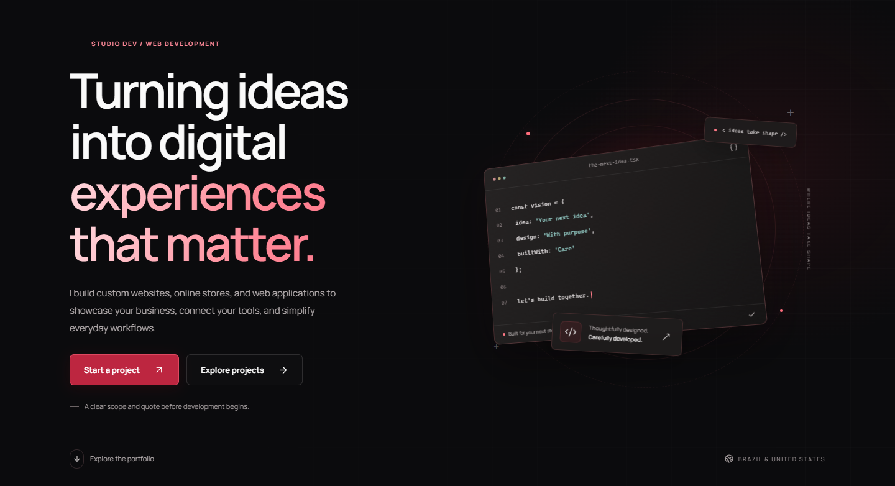

# Studio Dev

Developer focused on web applications, Windows software and practical testing. Seeking Junior Software Developer, Front-End, Full-Stack, Web Developer and QA Tester opportunities.

I work with JavaScript and TypeScript, React and Next.js, Node.js, C# and .NET WPF. My projects cover front-end interfaces, back-end services, HTTP APIs, relational databases, automated tests and application security boundaries.

## Studio Dev — main portfolio

**studiodev.dev** is the domain associated with my professional portfolio. A live deployment has not been confirmed, so no live-demo link is advertised here. These approved captures show the English homepage running locally.

[View the approved mobile homepage capture](assets/en-home-390.png).

The code-styled illustration is decorative interface artwork. It does not expose the application's implementation.

## Five selected projects

| Project | What it demonstrates |
|---|---|
| **[Celine — Discord Bot](https://github.com/Ak-Osama/celine-showcase)** | Node.js and discord.js automation, permission boundaries, AntiNuke protection, backup/recovery and a local Control Center |
| **[AUKi Jóias — Website / Catalog](https://github.com/Ak-Osama/auki-jewelry-showcase)** | React/Next.js catalog, search and filters, favorites and bag, product administration and order requests without online payment |
| **[Legacy Painting — Website / Dashboard](https://github.com/Ak-Osama/legacy-painting-showcase)** | Service pages, estimate forms, authentication, role-checked administration, Supabase persistence and CSV reporting |
| **[AK Color Panel — Windows Application](https://github.com/Ak-Osama/ak-color-panel-showcase)** | C#/.NET WPF, display profiles, hardware capability checks, restoration and selected HDR/color tests |
| **[Studio Dev — Professional Portfolio](https://github.com/Ak-Osama/studio-dev-showcase)** | Bilingual responsive presentation, accessible navigation, contact validation and server/browser checks |

Each public showcase documents verified behavior and its limitations. These repositories contain approved documentation and screenshots only; application implementation remains private.

## Engineering practice

- Front-end work: responsive interfaces, localization, keyboard interaction and explicit failure states.
- Back-end work: request validation, authorization, persistence and separate notification outcomes.
- QA: unit/integration checks, browser compatibility tests and dated evidence for builds and audits.
- Application security: permission checks, abuse controls, safe parsing and dependency review, with clear limits on what was actually tested.

Existing public documentation: [Celine policy repository](https://github.com/Ak-Osama/celine-docs). It is separate from the proposed bot showcase.

All project source remains off GitHub, including private repositories. This profile presents approved descriptions and screenshots; it does not distribute application implementation or grant a license to proprietary or client material.
